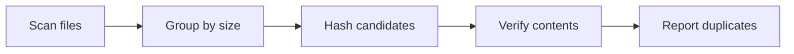

<h1 align="center">DuplicateFinder</h1>

<p align="center">
  Find duplicate files. Reclaim space. Keep what matters.
</p>

<p align="center">
  
  
  
  
</p>

<p align="center">
  <a href="#overview">Overview</a> ·
  <a href="#planned-features">Features</a> ·
  <a href="#how-it-works">How it works</a> ·
  <a href="#roadmap">Roadmap</a> ·
  <a href="#contributing">Contributing</a>
</p>

---

> [!NOTE]
> DuplicateFinder is currently in early development.
> The features described below are planned for the first release.

## Overview

DuplicateFinder is an open-source command-line utility being
built in modern C++ to detect duplicate files based on their
actual content, not just their names.

The goal is to provide a lightweight, efficient and transparent
way to identify redundant files and estimate how much storage
could potentially be recovered.

No cloud services. No unnecessary dependencies.
Just a focused local utility.

## Planned Features

| Feature | Description |
|---|---|
| Recursive scanning | Explore directories and their subdirectories. |
| Content-based detection | Identify files with identical contents, regardless of their names. |
| Efficient filtering | Eliminate unnecessary comparisons by grouping files by size. |
| Streaming hashing | Process large files without loading them entirely into memory. |
| Exact verification | Confirm matching files through binary comparison. |
| Scan reports | Display duplicate groups, scan statistics and potentially recoverable space. |
| Safe by default | Inspect files without deleting or modifying them. |

## How It Works

The planned detection pipeline follows four main stages:



1. **Scan** — Collect file paths and metadata.
2. **Filter** — Group files by size to eliminate impossible matches.
3. **Hash** — Calculate content fingerprints for candidate files.
4. **Verify** — Compare matching candidates byte by byte to confirm
   that their contents are identical.

Hashing is used as an optimization, not as proof of equality.
Exact binary comparison is intended to prevent false positives
caused by hash collisions.

## Example Usage

The following illustrates the intended command-line interface.
It is not yet available.

```bash
duplicatefinder ~/Downloads
```

Example of the planned output:

```text
Scanning directory...

Duplicate group #1
  photo.jpg
  photo_copy.jpg

Duplicate group #2
  document.pdf
  document_backup.pdf

Scan complete.
```

## Roadmap

### v0.1 — Core functionality

- [x] Initialize repository and MIT license
- [ ] Set up the C++ project with CMake
- [ ] Implement recursive directory scanning
- [ ] Implement binary file comparison
- [ ] Group files by size
- [ ] Detect and report duplicate groups

### v0.2 — Efficiency

- [ ] Implement streaming file hashing
- [ ] Optimize duplicate candidate selection
- [ ] Measure detection performance
- [ ] Handle filesystem errors and edge cases

### v1.0 — First stable release

- [ ] Command-line arguments and help menu
- [ ] Duplicate reports and storage estimation
- [ ] Automated tests
- [ ] Continuous integration with GitHub Actions
- [ ] Build and usage documentation
- [ ] Publish the first release

### Future ideas

- [ ] JSON report export
- [ ] Parallel file hashing
- [ ] Graphical desktop interface

## Technology Stack

- **C++17** — Core application
- **CMake** — Build system
- **C++ Standard Library** — Filesystem operations and data processing
- **GitHub Actions** — Continuous integration (planned)

## Design Principles

- **Correctness first:** verify actual file contents.
- **Efficiency:** avoid unnecessary file reads and comparisons.
- **Safety:** the first release will be read-only.
- **Simplicity:** keep the codebase focused and maintainable.
- **Transparency:** document the algorithms and their limitations.

## Contributing

DuplicateFinder is in its initial development stage.

Ideas, feedback and suggestions are welcome through
[GitHub Issues](https://github.com/Pablito-04/DuplicateFinder/issues).

Contribution guidelines will be added as the project matures.

## License

Released under the [MIT License](LICENSE).

---

<p align="center">
  <sub>Built with C++ · Open source · Work in progress</sub>
</p>
